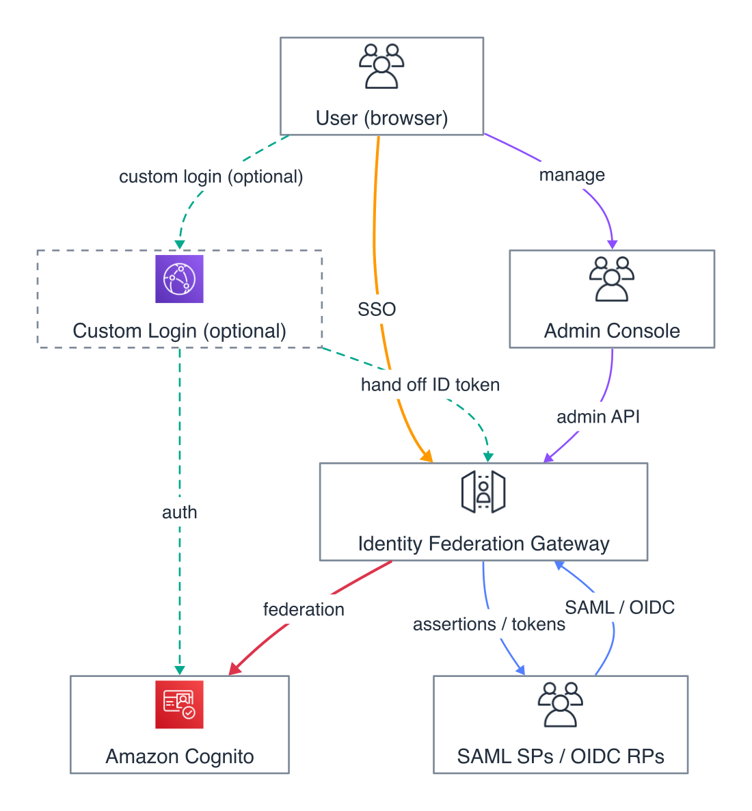
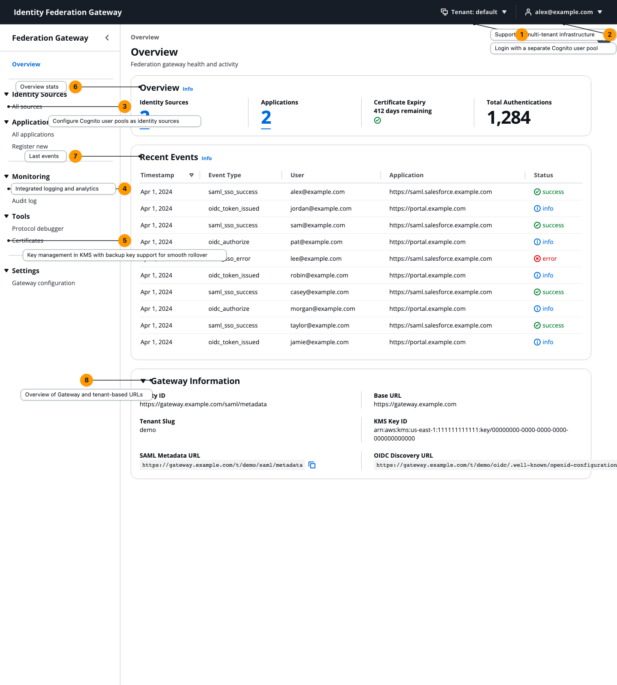
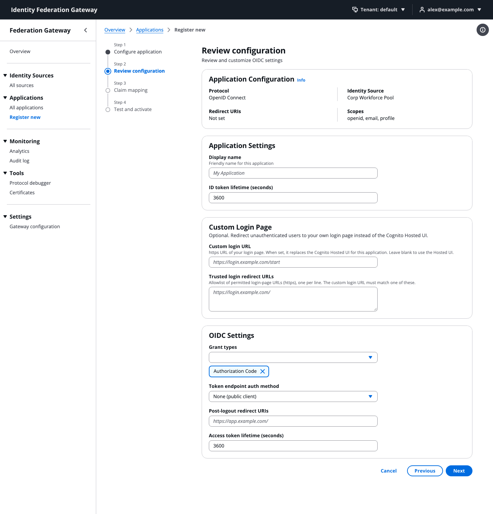
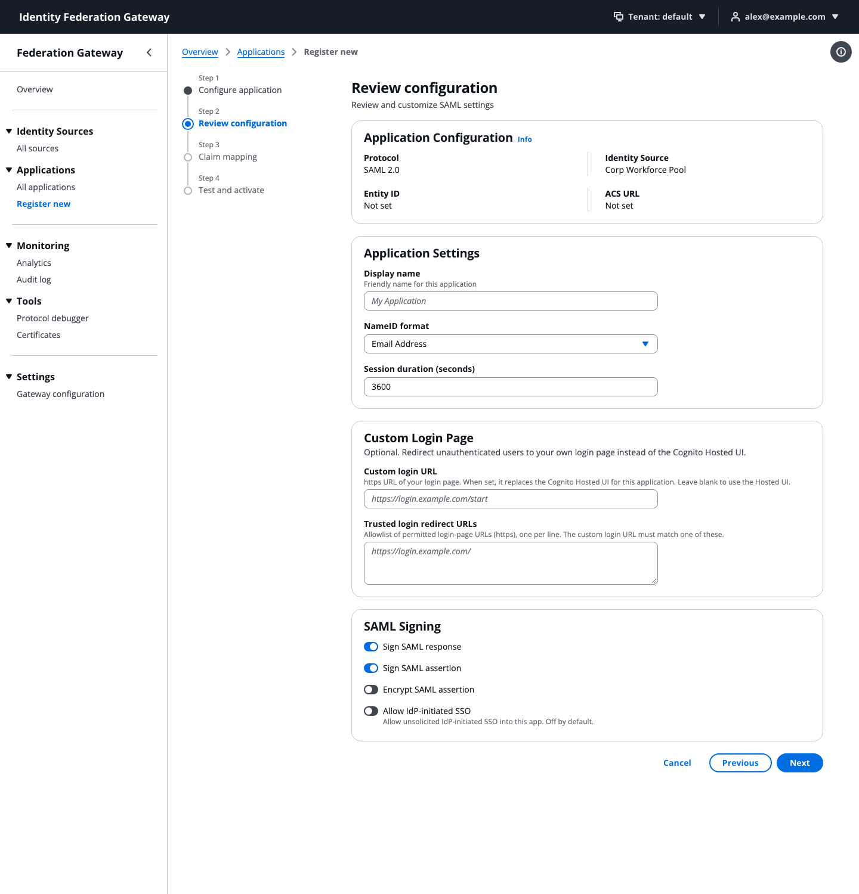
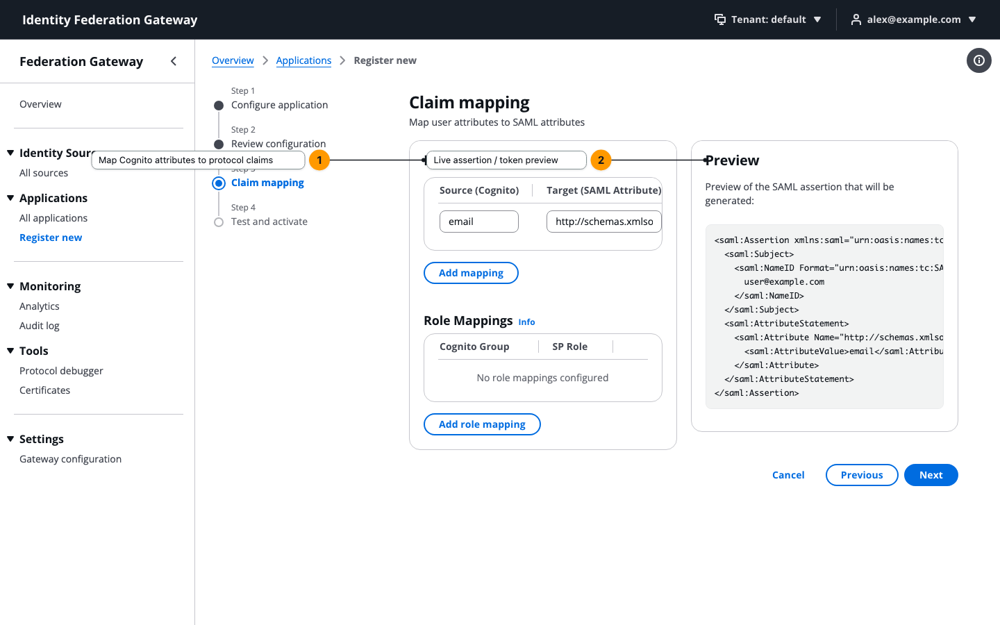
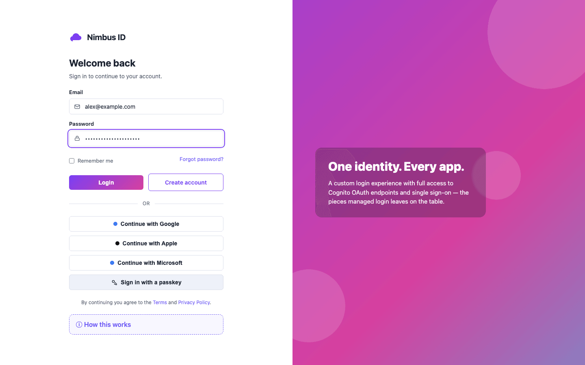
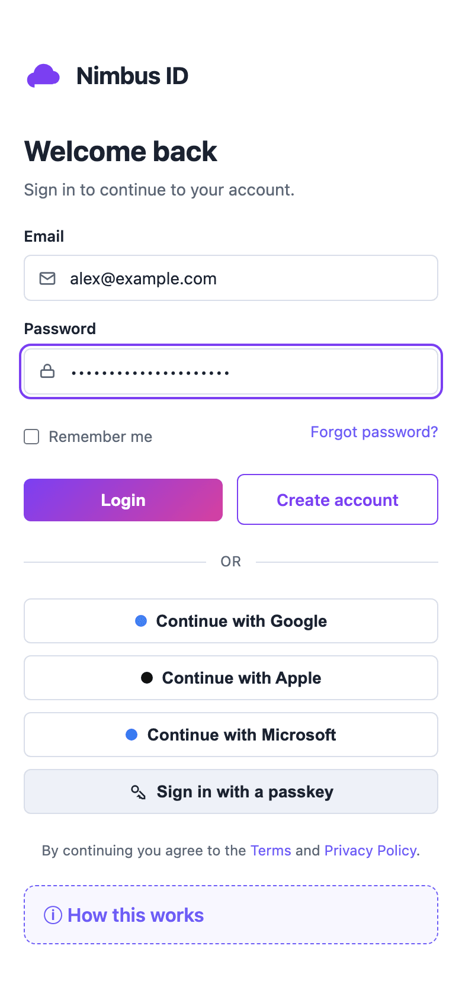

# Identity Federation Gateway

**A multi-tenant, serverless gateway that gives Amazon Cognito a SAML 2.0 IdP role, richer
per-tenant OIDC, and a fully custom login — without losing Cognito's OAuth endpoints or SSO.**

It fronts one or more [Amazon Cognito](https://aws.amazon.com/cognito/) user pools and presents
standards-compliant SAML 2.0 and OpenID Connect 1.0 endpoints per tenant, with configuration-driven
claim and role mapping — no per-application Lambda code.

> **📖 Full documentation** lives in [`docs/`](docs/) and publishes as a MkDocs Material site. Start
> with the [Introduction](docs/overview/introduction.md) or the
> [Quickstart](docs/deployment/quickstart.md).

## What it does

- **Adds a SAML 2.0 IdP to Cognito** — SSO, SLO, metadata, and signed assertions (RSA-SHA256 via
  AWS KMS) for apps that only speak SAML, which Cognito cannot issue on its own.
- **Extends Cognito's OIDC** — per-tenant issuers, token introspection, and per-application claim
  and role mapping with RS256 signing, beyond the single fixed issuer a pool gives you.
- **Enables a custom login page that keeps Cognito's OAuth endpoints and SSO** — bring your own
  branded UI (social buttons, passkeys, your own layout) while still using Cognito's
  `/oauth2/authorize` flow and single sign-on.

## Why it exists

Amazon Cognito is a solid OIDC provider, but it has three gaps this gateway closes:

- It **cannot issue SAML assertions** — SAML-only service providers can't integrate directly.
- It gives you **one OIDC issuer per pool** with a fixed claim set — no per-application mapping.
- The moment you build a **custom login UI**, you normally **lose access to the Cognito OAuth
  endpoints and hosted SSO**. The gateway's custom-login integration keeps both: a login page you
  fully control that still rides Cognito's OAuth endpoints and SSO session.

### How it compares to Amplify Identity Broker

Amplify Identity Broker is a related pattern for a custom front end over Cognito. The gateway is a
standalone, multi-tenant federation service rather than an app-embedded broker:

| | Identity Federation Gateway | Amplify Identity Broker |
|---|---|---|
| SAML 2.0 IdP role for Cognito | Yes (signed assertions via KMS) | No |
| Per-tenant OIDC issuers + per-app claim mapping | Yes, config-driven | Limited / app-coded |
| Custom login that keeps Cognito OAuth endpoints + SSO | Yes | Partial |
| Multi-tenant isolation (issuers, signing key, cross-pool) | Built in | Not a goal |
| Deployment | Standalone serverless stack | Amplify app component |

## Architecture at a glance

<picture>
  <source media="(prefers-color-scheme: dark)" srcset="docs/images/architecture-simple-dark.png">
  
</picture>

See the [detailed deployment architecture](docs/overview/architecture.md) for the full AWS resource
view (CloudFront, WAF, Lambda, DynamoDB, KMS).

## Admin console tour

A React SPA to manage tenants, identity sources, applications, and mappings.

<details open>
<summary><strong>Open the console tour</strong></summary>

<br>

**Overview** — gateway health, recent federation events, and per-tenant metadata/discovery URLs.



**Register an OIDC application** — redirect URIs, scopes, grant types, and token lifetimes.



**Register a SAML application** — Entity ID, ACS URL, NameID format, and signing options.



**Claim mapping** — map Cognito attributes to protocol claims with a live assertion preview.



</details>

## Custom login showcase

A bring-your-own login page (the `examples/custom-ui` demo, "Nimbus ID") that keeps full access to
Cognito's OAuth endpoints and SSO — the thing a hand-rolled custom UI normally gives up.

<table>
<tr>
<td width="60%" valign="top">

</td>
<td width="40%" valign="top">

</td>
</tr>
</table>

**What Managed Login cannot do that this can:**

- Fully custom layout and branding, not a themed Cognito Hosted UI.
- Custom social-login buttons wired to real Cognito `/oauth2/authorize` redirects.
- A passkey (WebAuthn) sign-in button.
- Your own Terms / Privacy links, "Remember me", and copy — while still using Cognito's OAuth
  endpoints and SSO session behind the scenes.

See [`examples/custom-ui`](examples/custom-ui/README.md) for how the social and passkey options are
configured (both default off).

## Quick start

Run everything locally — no AWS account needed:

```bash
make run-local      # Gateway on :8080 (in-memory store, mock KMS)
make test-sp        # SAML SP demo on :8081
make test-rp        # OIDC RP demo on :8082
make frontend-dev   # Admin console SPA on :3000
```

Run the custom-login demo (the "Nimbus ID" page above):

```bash
cd examples/custom-ui/frontend && npm run dev   # Demo login on :5174
```

Deploy to AWS (see the [Quickstart](docs/deployment/quickstart.md) for prerequisites and the
one-time backend bootstrap):

```bash
make deploy-dev   ENV=dev AWS_PROFILE=<profile>
make post-install ENV=dev AWS_PROFILE=<profile> ADMIN_EMAIL=you@example.com
```

## Documentation

| Topic | Link |
|-------|------|
| What it is and why | [Introduction](docs/overview/introduction.md) |
| Deployment architecture | [Architecture](docs/overview/architecture.md) |
| Data model | [Data model](docs/overview/data-model.md) |
| SAML 2.0 IdP | [Protocols → SAML](docs/protocols/saml.md) |
| OpenID Connect | [Protocols → OIDC](docs/protocols/oidc.md) |
| First deploy (new account) | [Quickstart](docs/deployment/quickstart.md) |
| Post-install (cert + admin) | [Post-install](docs/deployment/post-install.md) |
| Teardown | [Teardown](docs/deployment/teardown.md) |
| Cost | [Cost estimate](docs/overview/cost.md) |
| Security | [Security](docs/overview/security.md) |
| All `make` targets | [Make commands](docs/reference/make-commands.md) |

## Cost

The stack is serverless and scales to near-zero when idle — roughly **~$28–35/month** for an idle
dev deployment, dominated by AWS WAF. See the [cost estimate](docs/overview/cost.md) for the
per-service breakdown and how to generate a region-accurate figure with Infracost.

## Technologies

- **Go** with [crewjam/saml](https://github.com/crewjam/saml), [zitadel/oidc](https://github.com/zitadel/oidc),
  [Huma](https://github.com/danielgtaylor/huma), [guregu/dynamo](https://github.com/guregu/dynamo)
- **React 18** with [Cloudscape Design System](https://cloudscape.design) and TanStack Query
- **Terraform** with [terraform-aws-modules](https://github.com/terraform-aws-modules)

## Contributing & security

See [CONTRIBUTING.md](CONTRIBUTING.md) and [SECURITY.md](SECURITY.md).

## License

This project is provided as a sample implementation. See [LICENSE](LICENSE) for details.
