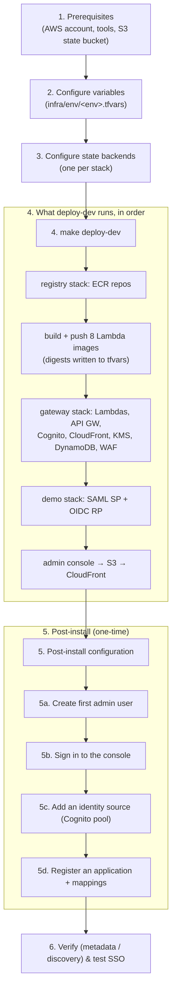

# Quickstart: deploy to a new AWS account

This guide walks a new customer through provisioning the Identity Federation Gateway
from scratch with Terraform, then completing the post-install configuration to sign in
and federate a first application.

> Time: ~30–45 minutes (most of it CloudFront provisioning). Everything is created in
> **one AWS account/region**. The infrastructure is split into three Terraform stacks
> (`registry`, `gateway`, `demo`) that are applied in order and destroyed in reverse.

## High-level steps



---

## 1. Before you start

Install the tools, check the account permissions, and create the S3 state bucket as
described in [Prerequisites](prerequisites.md).

- **Clone with symlinks enabled.** Each stack's `variables.tf` is a git symlink to
  `infra/variables.tf`. If `git config core.symlinks` is `false` (the default on Windows),
  the symlinks are checked out as one-line text files and every `terraform init` fails with
  *"Argument or block definition required … ../variables.tf"*. See
  [Troubleshooting](#troubleshooting).

```bash
git clone <this-repo> && cd <this-repo>
export ENV=dev                      # environment name: dev | staging | prod
export PROFILE=default              # your AWS CLI profile
export REGION=us-east-1             # the region you will deploy to
```

> **Pass the profile and region to `make` on the command line.** The Makefile sets
> `AWS_PROFILE := default` and `AWS_REGION := us-east-1`, which override variables exported
> in your shell. Run `make <target> AWS_PROFILE=$PROFILE AWS_REGION=$REGION`, as every
> command below does.

## 2. Configure variables

Create your variables file from the example and edit the values:

```bash
cp infra/env/dev.tfvars.example infra/env/$ENV.tfvars
```

All three stacks read this one file. Set at least these:

```hcl
environment    = "dev"                              # must match $ENV
owner          = "you@example.com"                  # tag value
aws_region     = "us-east-1"                        # must match $REGION
alert_email    = "ops@example.com"                  # SNS alerts; leave "" to skip the subscription
saml_entity_id = "https://gateway.example.com"      # the IdP entity ID this gateway advertises
state_bucket   = "my-tfstate-bucket"                # the S3 state bucket from step 1
state_bucket_region = "us-east-1"                   # the bucket's region; may differ from aws_region

# Leave these EMPTY for a first deploy (uses the generated CloudFront URLs).
# Set them later if you want custom domains via Route 53 + ACM.
custom_domain  = ""
dns_zone_name  = ""
```

Do not set `image_digests` by hand: `make push-function-images` (run by `make deploy-dev`)
writes the digest of every image it pushes into this file, and the gateway deploys each
Lambda by that digest. The remaining variables have defaults; see `infra/variables.tf`.

## 3. Configure the state backends

Each stack has its own state object and backend config. Copy the three examples and set
your bucket, region, and (optionally) the KMS key for state encryption:

```bash
for s in registry gateway demo; do
  cp infra/env/$s.dev.backend.hcl.example infra/env/$s.$ENV.backend.hcl
done
```

Keep each file's `key` as `<env>/<stack>/terraform.tfstate`: the `gateway` and `demo`
stacks read the other stacks' state at exactly those keys. These files are gitignored.

## 4. Deploy

```bash
make deploy-dev ENV=$ENV AWS_PROFILE=$PROFILE AWS_REGION=$REGION
```

`deploy-dev` runs these targets in order. You can also run them one at a time:

| Target | What it does |
|--------|--------------|
| `registry-init`, `registry-apply` | Creates one ECR repository per Lambda function, plus two for the demo apps. Repositories are **immutable**: a tag can be pushed once. |
| `push-function-images` | Builds the 8 arm64 binaries, pushes each image tagged with the current git commit, and writes every image digest to `infra/env/$ENV.tfvars` under `image_digests`. |
| `push-demo-images` | Builds and pushes the demo SAML SP and OIDC RP images. |
| `gateway-init`, `gateway-apply` | Provisions the Lambdas (by digest), API Gateway, the Cognito user pool (with `Admins`/`Operators` groups), DynamoDB tables, KMS keys, Secrets Manager secrets, the S3 + CloudFront console hosting, and AWS WAF. CloudFront takes several minutes. |
| `demo-init`, `demo-apply` | Deploys the demo SAML SP and OIDC RP (Lambda + API Gateway + CloudFront each). |
| `frontend-deploy` | Builds the admin console from the gateway stack's outputs, syncs it to S3, and invalidates CloudFront. |

> The `*-apply` targets run `terraform apply -auto-approve`. To review changes first, run
> `make tf-plan STACK=gateway ENV=$ENV AWS_PROFILE=$PROFILE` before applying.

Get your gateway URL (the console is served from the same CloudFront distribution):

```bash
terraform -chdir=infra/gateway output -raw base_url
# -> https://dxxxxxxxxxxxxx.cloudfront.net   (or https://<custom_domain> if you set one)
```

---

## 5. Post-install configuration

Terraform does **not** create an admin user. The gateway creates a built-in tenant named
`default` the first time the management API or the `saml-sso` function starts, and the
gateway's own Cognito app client is registered with the callback URLs for that tenant, so
this walkthrough uses `default`.

### 5a. Create your first admin user

The Cognito pool is admin-create-only, so create the user via the CLI, give it a permanent
password (no email needed), and set its tenant:

```bash
POOL=$(terraform -chdir=infra/gateway output -raw cognito_user_pool_id)
ADMIN_EMAIL="admin@example.com"

aws cognito-idp admin-create-user --user-pool-id "$POOL" --username "$ADMIN_EMAIL" \
  --message-action SUPPRESS --region "$REGION" --profile "$PROFILE" \
  --user-attributes Name=email,Value="$ADMIN_EMAIL" Name=email_verified,Value=true \
                    Name=custom:tenant_id,Value=default

aws cognito-idp admin-set-user-password --user-pool-id "$POOL" --username "$ADMIN_EMAIL" \
  --password '<a-strong-password>' --permanent --region "$REGION" --profile "$PROFILE"
```

Then run the post-install target, which seeds the SAML signing certificate and adds the
user to `Admins`:

```bash
make post-install ENV=$ENV AWS_PROFILE=$PROFILE AWS_REGION=$REGION ADMIN_EMAIL="$ADMIN_EMAIL"
```

See [Post-install](post-install.md) for why both steps are needed.

> RBAC: `Admins` can read **and** write; `Operators` is read-only. The console scopes you to
> the tenant in your `custom:tenant_id` claim (users without the claim fall back to `default`).
> The pool enforces MFA, so the first sign-in asks you to register an authenticator app.

### 5b. Sign in to the console

Open the `base_url` from step 4 and sign in with the admin email and password above. The
console authenticates against the gateway's Cognito pool through Managed Login.

### 5c. Add an identity source

In the console: **Identity Sources → Add source**. An identity source is the Cognito user
pool that authenticates your *end users*. For a quick test, point it at the gateway's own
pool and its backend app client:

```bash
terraform -chdir=infra/gateway output -raw cognito_user_pool_id
terraform -chdir=infra/gateway output -raw cognito_backend_client_id
terraform -chdir=infra/gateway output -raw cognito_domain
```

In production use a dedicated end-user pool with a public app client
(`ALLOW_USER_SRP_AUTH` + `ALLOW_REFRESH_TOKEN_AUTH`). That client's callback URLs must
include `<base_url>/t/<tenant>/saml/acs` and `<base_url>/t/<tenant>/oidc/callback` for every
tenant that uses it, or Cognito rejects the sign-in redirect. (Each section has an **Info**
link explaining the fields.)

### 5d. Register an application

In the console: **Applications → Register new**. Choose SAML or OIDC, bind the identity
source, and configure endpoints, claim/role mappings, and (optionally) a
[custom login page](../guides/custom-login.md). The **Integration** tab then gives you
the metadata URL / discovery URL and certificate to hand to the relying party.

### Adding more tenants

Create a tenant from the console's tenant menu (**Create tenant…**) or with the API
(`POST /api/v1/tenants` with an `Admins` ID token). For each new tenant slug, add its
`/t/<slug>/saml/acs` and `/t/<slug>/oidc/callback` URLs to the identity source's app
client callback URLs, and set `custom:tenant_id` to the slug on that tenant's admins.

---

## 6. Verify

```bash
BASE=$(terraform -chdir=infra/gateway output -raw base_url)

# SAML IdP metadata for the default tenant
curl -s "$BASE/t/default/saml/metadata" | head

# OIDC discovery for the default tenant
curl -s "$BASE/t/default/oidc/.well-known/openid-configuration" | jq .
```

Then run an end-to-end SSO from your application, or from the demo apps:

```bash
terraform -chdir=infra/demo output -raw demo_saml_sp_url
terraform -chdir=infra/demo output -raw demo_oidc_rp_url
```

Register each demo app in the console (SAML for the SP, OIDC for the RP) before you test it.

### Optional: the Custom UI demo

A standalone React demo that shows building your own login UI against Cognito lives in
[`examples/custom-ui`](https://github.com/aws-samples/sample-aws-cognito-oidc-saml-proxy/tree/main/examples/custom-ui).
Deploy it separately (S3 + CloudFront) to exercise login, registration, password reset,
token refresh, the gateway's custom login page flow, and the IdP-initiated app launcher.
See [Custom login pages](../guides/custom-login.md).

---

## 7. Teardown

```bash
make destroy-dev ENV=$ENV AWS_PROFILE=$PROFILE AWS_REGION=$REGION
```

See [Teardown](teardown.md) for the per-stack order and notes.

## Troubleshooting

| Symptom | Cause / Fix |
|---------|-------------|
| `terraform init` or `validate` fails: *Argument or block definition required … `../variables.tf`* | The stack's `variables.tf` symlink was checked out as a text file. Run `git config core.symlinks true`, then `git checkout -- infra/registry/variables.tf infra/gateway/variables.tf infra/demo/variables.tf`. |
| `terraform init` asks for `bucket`, `key`, and `region` | The stack's `infra/env/<stack>.<env>.backend.hcl` is missing. Create it (step 3). |
| `gateway` or `demo` apply fails reading remote state | `state_bucket` (and `state_bucket_region`, if the bucket is in another region) is not set in the tfvars, or the backend `key` values do not follow `<env>/<stack>/terraform.tfstate`. |
| `push-function-images` fails: *tag … already exists* | ECR repos are immutable and images are tagged with the git commit. Commit your change (or check out a new commit) before pushing again. |
| `gateway-apply` fails: *Invalid index* on `var.image_digests[each.key]` | `image_digests` in the tfvars is missing a function. The gateway deploys by digest only, so run `make push-function-images` first. |
| Lambda create fails: *decreases account's UnreservedConcurrentExecution below its minimum* | Every function reserves `lambda_reserved_concurrency` (default 50, so 400 in total). New accounts can have a lower concurrency quota. Request a quota increase or set `lambda_reserved_concurrency = -1`. |
| Console loads but every data call returns 500 | The SAML signing certificate hasn't been created yet. Run `make post-install` (5a). |
| Console loads but API calls return 401/403 | Your user isn't in `Admins`/`Operators` (run `make post-install` with `ADMIN_EMAIL`, then sign out and back in), or its `custom:tenant_id` doesn't match an existing tenant (5a). |
| Sign-in redirect fails with *redirect_mismatch* | The identity source's app client is missing the `/t/<tenant>/saml/acs` or `/t/<tenant>/oidc/callback` URL for the tenant you used (5c). |
| Cognito sign-up/reset emails never arrive | New accounts have SES in sandbox. For admin login this is fine (the password is set directly in 5a). Verify an SES identity and set `ses_from_email_address` for real email. |
| `enable_public_iac_templates` apply error | Leave it `false` in accounts that enforce S3 Block Public Access. |
