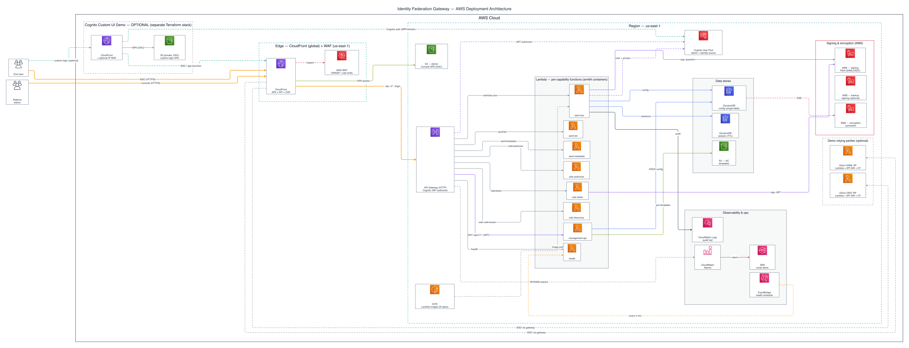
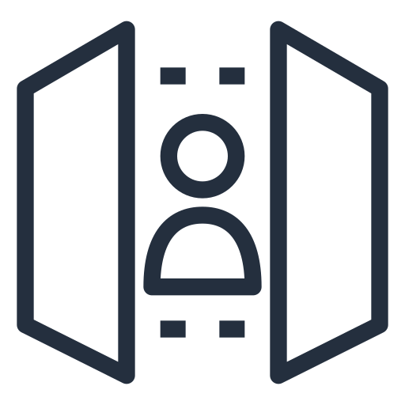

# Deployment Architecture

This document describes the AWS deployment architecture of the Identity Federation
Gateway — a multi-tenant, serverless SAML 2.0 IdP and OIDC Provider that fronts
Amazon Cognito user pools.

The diagram above is generated from [`diagrams/architecture.json`](../diagrams/architecture.json).
An editable draw.io version of the same architecture is available at
[`diagrams/identity-federation-gateway.drawio`](../diagrams/identity-federation-gateway.drawio)
([rendered PNG](../images/identity-federation-gateway.png)).
The sections below describe each component shown, grouped the same way as the diagram.

## Gateway icon

{ width="96" }

This is the icon for the Identity Federation Gateway. It shows two open doors, for the
gateway, with a user standing in the doorway, for identity. Use it wherever the gateway
appears as one component: architecture diagrams, web pages, and presentations. Don't
use the generic AWS Lambda or API Gateway icons to stand for the whole gateway. Use
those only when a diagram shows the individual Lambda functions or the HTTP API on
their own.

| File | Use on |
|---|---|
| [`Res_Identity-Federation-Gateway_48_Dark.svg`](../images/icons/Res_Identity-Federation-Gateway_48_Dark.svg) (white lines) | Dark backgrounds, such as dark slide themes and dark web pages |
| [`Res_Identity-Federation-Gateway_48_Light.svg`](../images/icons/Res_Identity-Federation-Gateway_48_Light.svg) (`#242F3E` lines) | Light backgrounds, such as draw.io, light slides, and docs pages |
| `Res_Identity-Federation-Gateway_48_{Dark,Light}.png` | Tools that can't import SVG (512 × 512 px, transparent background) |

The icon follows the AWS resource-icon style: a 48 × 48 grid, 2 px lines, and no
coloured tile. Without the tile, nobody will mistake it for an AWS service icon. Don't
add a tile, recolour it, or redraw it. Size it like other resource icons, and label it
"Identity Federation Gateway" (or "Gateway" where space is tight).

## Actors

- **Platform Admin** — operator who manages tenants, identity sources, applications,
  and claim/role mappings through the administration console (a React SPA). All admin
  traffic is HTTPS and authenticated against the Cognito user pool.
- **End User** — the person being federated. They reach the gateway over HTTPS to
  complete a SAML or OIDC single sign-on flow initiated by a relying party.

## Edge — CloudFront + WAF

- **CloudFront** — the single public entry point. It serves the admin console SPA
  from S3 and routes API and protocol traffic (`/api`, `/t/*`, `/login`) to API
  Gateway. It also applies the Content Security Policy and other response headers.
- **AWS WAF** — a web ACL on CloudFront (created in us-east-1) with the AWS managed Core
  rule set, Known bad inputs, and Amazon IP reputation list rule groups, plus
  endpoint-specific rate limits. A regional web ACL with the same rule groups is created
  but not associated, because WAFv2 cannot attach to an API Gateway HTTP API stage. The
  CloudFront origin-verify secret keeps traffic on CloudFront.

## Region — us-east-1

Core regional resources sitting behind the edge.

- **S3 — Admin Console SPA** — private bucket holding the built React/TypeScript
  single-page app, served only through CloudFront via Origin Access Control (OAC).
- **API Gateway (HTTP API)** — front door for all gateway endpoints. Management API
  routes (`ANY /api/v1/*`) are protected by a **Cognito JWT authorizer**; the SAML and
  OIDC protocol routes are public per their respective specifications.
- **Cognito User Pool** — serves two roles: it authenticates platform admins for the
  console, and it acts as an upstream identity source whose users and `cognito:groups`
  are federated out as SAML assertions or OIDC tokens.
- **ECR** — holds the container images for the Lambda functions (one repository per
  function: 8 gateway + 2 demo = 10 total), in the separate `registry` Terraform stack.
  The repositories are immutable, and each gateway Lambda deploys by image digest. Lambda
  pulls its image from ECR at deploy time.

### Lambda — per-capability functions (arm64 containers)

Each capability is an independent ARM64 container Lambda, invoked by API Gateway:

- **saml-sso** — handles `/saml/sso`, the Cognito callback (`/saml/acs`), custom login
  completion (`/saml/login/complete`), and IdP-initiated SSO (`/saml/idp-initiate`). Reads
  tenant/app config and session state, signs the SAML assertion with KMS, and looks up the
  user and groups from Cognito. Writes audit steps to CloudWatch Logs.
- **saml-slo** — front-channel Single Logout (`/saml/slo`).
- **saml-metadata** — serves IdP `<EntityDescriptor>` metadata (`/saml/metadata`).
- **oidc-authorize** — OIDC/OAuth2 authorization endpoint, the Cognito callback, and
  custom login completion (`/oidc/login/complete`).
- **oidc-token** — token, introspection, and revocation endpoints; signs issued JWTs
  with KMS (RS256).
- **oidc-discovery** — discovery document, JWKS, UserInfo, and end-session endpoints.
- **management-api** — backs the admin console; all routes require a valid Cognito JWT.
  Performs CRUD on the config table and writes IaC templates to S3.
- **health** — `/health`; EventBridge invokes it every 5 minutes as a synthetic check.

### Data stores

- **DynamoDB — config (single-table)** — all tenant, identity-source, application,
  SAML/OIDC config, claim-mapping and role-mapping entities, keyed by composite
  `PK`/`SK`. Encrypted at rest with the symmetric KMS encryption key.
- **DynamoDB — session (TTL)** — short-lived protocol state: AuthnRequest replay guards,
  SAML sessions, pending custom logins, OIDC requests, codes, and tokens, and a 24-hour
  copy of audit steps. Items expire automatically via DynamoDB TTL.
- **S3 — IaC templates** — stores generated infrastructure-as-code templates produced
  by the management API for onboarding.

### Signing & encryption (KMS)

- **KMS — signing (RSA)** — asymmetric RSA key used to sign SAML responses/assertions
  (RSA-SHA256) and OIDC tokens (RS256).
- **KMS — backup signing** — second RSA signing key, created by default
  (`enable_backup_signing_key`). Promoting the backup certificate rolls signing to this key.
- **KMS — encryption (symmetric)** — symmetric key for server-side encryption of both
  DynamoDB tables, the audit log group, the Secrets Manager secrets below, and other data
  at rest.

### Shared secrets (Secrets Manager)

Each Lambda fetches the secrets it needs once at cold start; only the secret ARN is
placed in the function environment, never the value.

- **Edge secret** — the CloudFront origin-verify token every request-handling function
  checks so the API is only reachable through CloudFront.
- **OIDC crypto key** — 32-byte AES-GCM key for opaque bearer tokens, shared by
  `oidc-authorize`, `oidc-token` and `oidc-discovery`.
- **Cookie key** — 32-byte root key for the signed and encrypted login cookies, shared
  by `saml-sso` and `oidc-authorize` so a cookie minted by one instance is readable by
  every other instance.

### Observability & ops

- **CloudWatch Logs** — central audit trail (`/identity-gateway/audit`, 365-day retention,
  KMS-encrypted); Lambda functions write structured flow audit events here.
- **CloudWatch Alarms** — API Gateway 4xx and 5xx errors, DynamoDB throttles, audit-log
  write failures, and signing-certificate expiry.
- **SNS** — delivers email alerts when an alarm fires.
- **EventBridge** — scheduled rule that invokes the health Lambda every 5 minutes.

### Demo relying parties (optional)

- **Demo SAML SP** and **Demo OIDC RP** — optional sample apps (each Lambda + API
  Gateway + CloudFront), deployed by the separate `demo` Terraform stack, that initiate
  SSO through the gateway to demonstrate the end-to-end flow. Shown dashed because they
  are optional.

## Cognito Custom UI Demo — OPTIONAL (separate Terraform stack)

An optional, separately deployed stack demonstrating a custom Cognito login UI:

- **CloudFront + optional IP WAF** — edge for the custom login SPA, with optional
  IP-allowlist WAF.
- **S3 (private, OAC)** — bucket holding the custom login SPA, served only via
  CloudFront with OAC.

The custom UI authenticates end users directly against the Cognito user pool
(SRP/refresh) and then hands off to the gateway, either as an application's custom login
page (it posts the ID token to `/login/complete`) or as an IdP-initiated app launcher.
See [Custom login pages](../guides/custom-login.md). This whole cluster is
dashed/optional and lives in its own Terraform stack (`examples/custom-ui/infra`).

## Request flow summary

1. An admin or end user reaches **CloudFront**, which is inspected by **WAF**.
2. SPA asset requests are served from the **Admin Console S3** bucket; everything else
   is routed to **API Gateway**.
3. API Gateway authorizes management traffic via the **Cognito JWT authorizer** and
   dispatches protocol traffic to the matching **Lambda** function.
4. Lambdas read/write **DynamoDB** (config + session), sign with **KMS**, resolve users
   and groups from **Cognito**, and emit audit events to **CloudWatch Logs**.
5. **EventBridge** drives periodic health checks; **CloudWatch Alarms** notify via
   **SNS** on metric breaches.
