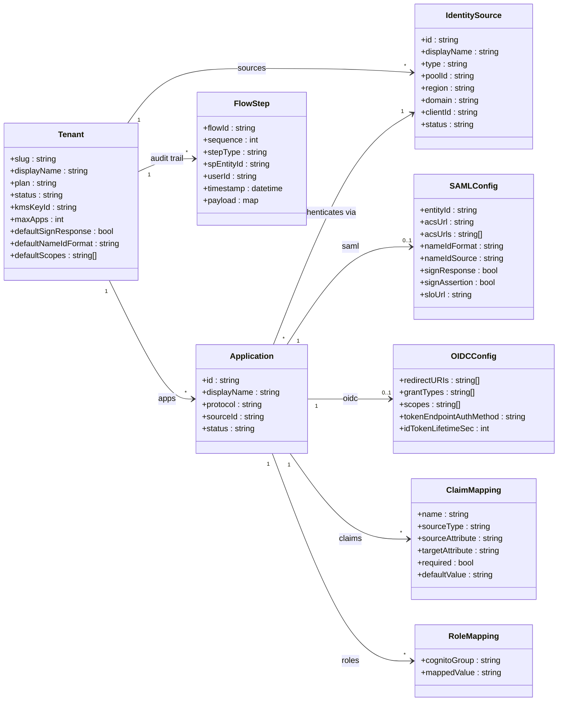

# Data model

The gateway uses two Amazon DynamoDB tables with composite keys (`PK`, `SK`), both encrypted
with the AWS KMS encryption key:

- **Config table**: tenants, identity sources, applications, SAML/OIDC settings, claim and
  role mappings, and signing certificates. The `entityId-index` GSI resolves a SAML entity
  ID to its tenant and application.
- **Session table**: short-lived protocol state and a 24-hour copy of audit steps. Items
  expire through DynamoDB TTL; the permanent audit record is in Amazon CloudWatch Logs.

## DynamoDB key design

| Table | Entity | PK | SK |
|-------|--------|----|----|
| Config | Tenant config | `TENANT#{slug}` | `CONFIG` |
| Config | Identity source | `TENANT#{slug}` | `SOURCE#{id}` |
| Config | Application | `TENANT#{slug}` | `APP#{id}` |
| Config | SAML config | `TENANT#{slug}` | `APP#{id}#SAML` |
| Config | OIDC config | `TENANT#{slug}` | `APP#{id}#OIDC` |
| Config | Claim mapping | `TENANT#{slug}` | `APP#{id}#CLAIM#{name}` |
| Config | Role mapping | `TENANT#{slug}` | `APP#{id}#ROLE#{group}` |
| Config | Signing cert | `SYSTEM#CONFIG` | `SYSTEM#SIGNING_CERT` (also `_NEXT`, `_BACKUP`) |
| Session | Audit step | `TENANT#{slug}#FLOW#{flowId}` | `STEP#{timestamp}#{random}` |
| Session | Replay guard | `REPLAY#{requestId}` | `_` |
| Session | SAML session participant | `SESSION#{sessionIndex}` | `SP#{entityId}` |
| Session | Pending custom login | `PENDINGLOGIN#{flowId}` | `_` |
| Session | OIDC auth request | `AUTHREQ#{id}` | `META` |
| Session | OIDC authorization code | `AUTHCODE#{code}` | `META` |
| Session | OIDC access token | `TOKEN#{id}` | `META` |
| Session | OIDC refresh token | `REFRESHTOKEN#{token}` | `META` |
| Session | OIDC session index | `OIDCSESSION#t:{tenant}#u:{sub}#c:{clientId}` | `TOKEN#{tokenRef}` |

The `entityId-index` GSI keys on `GSI1PK` = `ENTITY#{slug}#{entityId}` and
`GSI1SK` = `TENANT#{slug}`. Session items expire through the `ttl` attribute.
