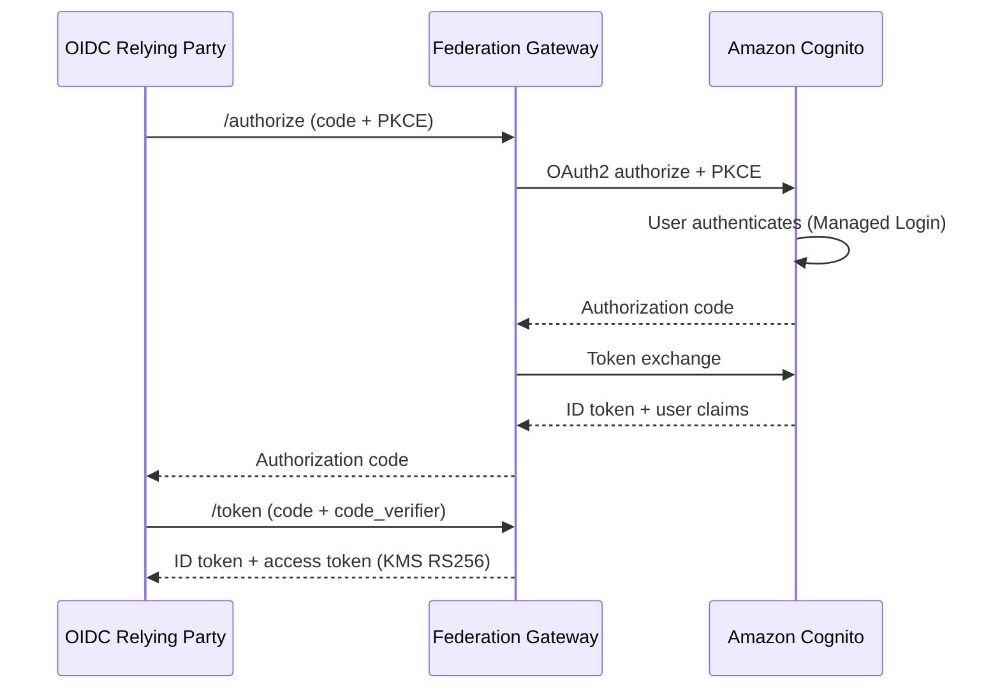

# OpenID Connect 1.0 Provider

Amazon Cognito user pools include a standards-compliant
[OpenID Connect Core 1.0](https://openid.net/specs/openid-connect-core-1_0.html) Provider
with a single issuer per pool and a fixed claim set. The Identity Federation Gateway
extends this with capabilities not available natively.

## Authorization code flow

## What the gateway adds over native Cognito

| What the gateway adds | What Amazon Cognito provides natively |
|---|---|
| Multi-tenant issuers (`/t/{tenant}/oidc`) | Single issuer per user pool |
| Declarative per-app claim mappings (config, not Lambda code) | Pre-token-generation Lambda trigger |
| Token introspection endpoint ([RFC 7662](https://datatracker.ietf.org/doc/html/rfc7662)) | — |
| Cross-pool federation (one gateway, multiple Cognito pools) | One pool per app client set |
| Per-tenant KMS signing keys | AWS-managed pool signing keys |
| Unified SAML + OIDC management API and UI | Separate console/API per protocol |
| Raw `cognito:groups` passed as `groups` claim | Same (`cognito:groups` in ID token) |

Both the gateway and Amazon Cognito support: PKCE (S256), public and confidential clients,
per-app redirect URI validation, configurable token lifetimes, RS256 signing, discovery,
JWKS, UserInfo, and token revocation.

## Claims

The gateway captures the claims from the verified Cognito ID token at login and persists
them with the authorization request, the refresh token and the access token. The ID token,
the UserInfo response and token introspection are all built from those stored records, so
the result is identical whether the endpoints run in one process or on separate Lambda
functions.

| Claim | Scope | ID token | UserInfo | Source |
|---|---|---|---|---|
| `sub` | `openid` | yes | yes | Cognito `sub` |
| `email` | `email` | yes | yes | Cognito `email`. **Omitted** when Cognito provides none; the gateway never substitutes the subject or any other value for it. |
| `email_verified` | `email` | yes | yes | Cognito `email_verified` verbatim; `false` when the claim is absent or the address is missing. |
| `given_name`, `family_name`, `name` | `profile` | yes | yes | Cognito `given_name` / `family_name`; `name` is emitted only when both are present. |
| `preferred_username` | `profile` | yes | yes | The Cognito email; omitted when there is none. |
| `groups` | — | yes | yes | Raw `cognito:groups`, emitted whenever the user has any. |
| per-app mapped claims | — | yes | yes | The application's claim and role mappings (see below). |

### Per-app claim mappings

The claim mappings configured for an OIDC application (Mappings tab, or
`/api/v1/applications/{id}/claim-mappings` and `/role-mappings`) are applied to the ID
token **and** the UserInfo response,
the same way the SAML assertion maker applies them to SAML attributes:

- `cognito` / `attribute` mappings resolve a Cognito field (`email`, `given_name`,
  `family_name`, `name`, `sub`, `username`) or a custom attribute (with or without the
  `custom:` prefix) and emit it under the target name; `defaultValue` fills in when the
  source is empty.
- `groupMapping` mappings emit, as a string array, the role values mapped from the user's
  Cognito groups.
- `static` mappings emit their `defaultValue`.

A mapping whose target is a standard or reserved claim name (`sub`, `iss`, `aud`, `exp`,
`iat`, `nbf`, `nonce`, `at_hash`, `c_hash`, `azp`, `auth_time`, `amr`, `acr`, `email`,
`email_verified`, `name`, `given_name`, `family_name`, `preferred_username`) is ignored and
logged; mapped values can never overwrite the identity claims above.

## Endpoints (per tenant)

| Path | Description |
|------|-------------|
| `/t/{tenant}/oidc/.well-known/openid-configuration` | [OpenID Connect Discovery 1.0](https://openid.net/specs/openid-connect-discovery-1_0.html) |
| `/t/{tenant}/oidc/authorize` | Authorization endpoint ([RFC 6749](https://datatracker.ietf.org/doc/html/rfc6749)) |
| `/t/{tenant}/oidc/oauth/token` | Token endpoint |
| `/t/{tenant}/oidc/oauth/introspect` | Token introspection ([RFC 7662](https://datatracker.ietf.org/doc/html/rfc7662)) |
| `/t/{tenant}/oidc/userinfo` | UserInfo endpoint ([OpenID Connect Core 1.0 §5.3](https://openid.net/specs/openid-connect-core-1_0.html#UserInfo)) |
| `/t/{tenant}/oidc/keys` | JSON Web Key Set ([RFC 7517](https://datatracker.ietf.org/doc/html/rfc7517)) |
| `/t/{tenant}/oidc/revoke` | Token revocation ([RFC 7009](https://datatracker.ietf.org/doc/html/rfc7009)) |
| `/t/{tenant}/oidc/end_session` | RP-Initiated Logout ([OpenID Connect RP-Initiated Logout 1.0](https://openid.net/specs/openid-connect-rpinitiated-1_0.html)) |
