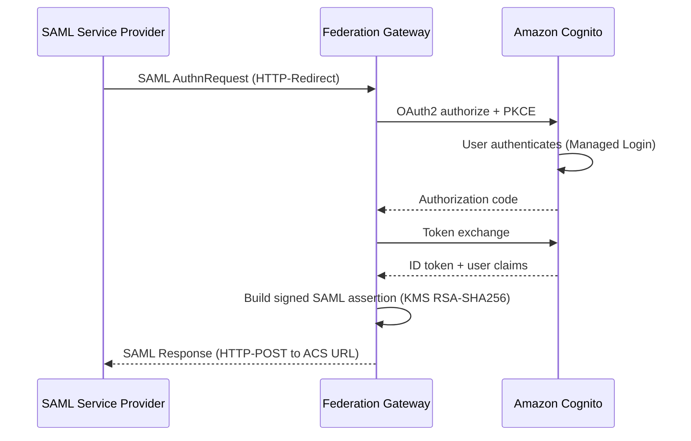

# SAML 2.0 Identity Provider

Amazon Cognito acts as a SAML **Service Provider** — it consumes assertions but does not
issue them. The Identity Federation Gateway implements the SAML 2.0 **Identity Provider**
role per the [OASIS SAML 2.0 Core specification](http://docs.oasis-open.org/security/saml/v2.0/saml-core-2.0-os.pdf),
supporting:

- The Web Browser SSO Profile with **HTTP-Redirect** and **HTTP-POST** bindings
- `<AuthnRequest>` processing
- Signed `<Response>` and `<Assertion>` elements (RSA-SHA256, via AWS KMS)
- `<EntityDescriptor>` metadata per the [SAML 2.0 Metadata specification](http://docs.oasis-open.org/security/saml/v2.0/saml-metadata-2.0-os.pdf)
- Front-channel Single Logout via `<LogoutRequest>` / `<LogoutResponse>` (HTTP-Redirect
  binding) per the [SAML 2.0 Profiles specification](http://docs.oasis-open.org/security/saml/v2.0/saml-profiles-2.0-os.pdf)

## Single sign-on flow

## What the gateway adds over native Cognito

| What the gateway provides | Amazon Cognito natively |
|---|---|
| Full SAML 2.0 IdP (SSO, SLO, metadata, assertions) | SAML Service Provider only — cannot issue assertions |
| Signed responses and assertions (RSA-SHA256 via AWS KMS) | — |
| Per-app ACS URLs, NameID formats, and claim mappings | — |
| Group-to-role mappings (Cognito group to SAML role value) | — |
| Per-app SAML metadata endpoint | — |
| AuthnRequest replay detection | — |
| Single gateway signing key (KMS) with an optional backup key for rotation | — |
| Front-channel SLO (HTTP-Redirect) | — |

## Endpoints (per tenant)

| Path | Description |
|------|-------------|
| `/t/{tenant}/saml/metadata` | IdP metadata (`<EntityDescriptor>`) |
| `/t/{tenant}/saml/metadata/{appId}` | Per-application IdP metadata |
| `/t/{tenant}/saml/sso` | Single Sign-On (HTTP-Redirect, HTTP-POST) |
| `/t/{tenant}/saml/slo` | Single Logout (HTTP-Redirect) |
| `/t/{tenant}/saml/login/complete` | Custom login page hand-back (ID token + `state`) |
| `/t/{tenant}/saml/idp-initiate` | IdP-initiated SSO (ID token + `entityId`), per-app opt-in |

## Configuration fields

A SAML application's configuration is set through the management API (`saml` block on
`POST`/`PUT /api/v1/applications`) and the admin console. Every stored field is either
honoured by the SSO path or refused by the API, so a configuration never describes
behaviour the gateway does not deliver.

### Honoured

| Field | Effect | Bounds | Default (`0`/omitted) |
|-------|--------|--------|------------------------|
| `sessionDurationSec` | Lifetime of the gateway SAML session: `saml_session` cookie `Max-Age` and the assertion's `AuthnStatement/@SessionNotOnOrAfter` | 300–86400 s (422 outside) | 3600 s via the API; 8 h for records with `0` |
| `clockSkewSec` | Allowance subtracted from the assertion's `Conditions/@NotBefore` (never earlier than the SP's `IssueInstant`) | 0–600 s (422 outside) | 180 s |
| `encryptAssertion` | When `true`, the SP's imported encryption certificate is advertised and the assertion is encrypted to it. When `false`, a stored certificate is ignored and the assertion is sent signed but in clear | requires an encryption certificate imported from SP metadata | `false` |
| `allowIdpInitiated` | Enables `/saml/idp-initiate` for this SP | — | `false` |
| `nameIdFormat`, `nameIdSource` | See [NameID](#nameid) | — | persistent / `sub` |

Stored records outside the bounds are clamped on the SSO path rather than honoured
verbatim.

### Refused

| Request | Status | Reason |
|---------|--------|--------|
| `signResponse: false` or `signAssertion: false` | 422 | The gateway always signs both the response and the assertion (RSA-SHA256 via KMS) |
| `encryptAssertion: true` without an SP encryption certificate | 422 | The certificate only comes from metadata import; there is nothing to encrypt to |
| `sessionDurationSec` / `clockSkewSec` outside the bounds above | 422 | See bounds |
| Tenant `kmsKeyId` / `kmsKeyArn` | 422 | Per-tenant signing keys are not supported; all tenants sign with the gateway key |
| SP metadata with `WantAuthnRequestsSigned="true"` | not settable via the API; the SSO endpoint answers 500 and logs the reason, and `POST /applications/{id}/validate` reports an error | AuthnRequest signature verification is not implemented, so the gateway refuses to serve an SP whose administrator believes requests are verified |

## NameID

The Subject `<NameID>` of every assertion is derived from the application's `nameIdFormat`
and `nameIdSource` together with the **verified** claims of the Cognito ID token:

| Configured format | Issued NameID |
|---|---|
| `emailAddress` (or `nameIdSource: email` with any format) | The user's `email`, **only** when Cognito asserts `email_verified=true`. Otherwise a persistent NameID equal to the Cognito `sub` is issued instead, and the fallback is logged (`saml nameid fallback`, reason `email_unverified`). |
| `persistent` | The Cognito `sub` (stable per user, not user-chosen). |
| `transient` | A fresh random value per session (the SAML session ID). |
| `unspecified` / custom URN | The Cognito `sub`, with the configured format echoed unchanged. |

An email address a user typed at sign-up is not an identity until Cognito has verified it,
so an unverified email is never used as the subject an SP keys its accounts on. A token
without a `sub` is rejected (HTTP 401). Pairwise (per-SP hashed) persistent identifiers
are not issued: they would require a secret that is never rotated, which the deployment
does not provision.

## Attribute release

A service provider receives **only** the attributes an administrator has mapped for that
application (claim mappings and group-to-role mappings). The gateway never emits the
crewjam/library default attribute set (`uid`, `mail`, `givenName`, `sn`,
`eduPersonPrincipalName`, `eduPersonAffiliation`, `subject-id`), the user's raw
`cognito:groups`, or any `custom:*` attribute that is not explicitly mapped. An application
with no mappings receives a Subject-only assertion with no `<AttributeStatement>` at all.
If the application or its mappings cannot be resolved for a request, nothing is released
and a warning is logged — the gateway does not fall back to the defaults.

Mappings whose source type is `cognito` (or its wizard alias `attribute`) read a Cognito
claim (`email`, `given_name`, `family_name`, `sub`, `username`, or a `custom:*` attribute
by its name without the prefix); `groupMapping` releases the role values mapped from the
user's groups; `static` releases a fixed value.

## Custom login and IdP-initiated SSO

An application may replace the Cognito Managed Login with its own login page
(`customLoginUrl`). The gateway redirects the user there with a `state` value and the page
posts a Cognito ID token plus that `state` back to `/saml/login/complete`. An application
that opts in to IdP-initiated SSO can also be launched directly by posting an ID token and
the target `entityId` to `/saml/idp-initiate`.

!!! note "Browser binding"
    - **Login hand-back.** The redirect to the custom login page sets a short-lived,
      signed `__Host-saml_login` cookie bound to `state`. `/saml/login/complete` only
      accepts a completion from the browser that carries a matching cookie; anything else
      is rejected with 403 and the pending flow is left untouched for the real browser.
    - **IdP-initiated launches.** An `id_token` sent as a form field is accepted only when
      the request's `Origin` (or `Referer`) is the gateway itself or the origin of the
      app's `customLoginUrl` / `trustedLoginRedirectUris`. A missing or foreign origin is
      rejected with 403. Requests that send the token in an `Authorization: Bearer` header
      are exempt, because a browser cannot add that header cross-site without a CORS
      preflight.
    - An IdP-initiated launch does not set a `saml_session` cookie; a later SP-initiated
      login simply re-authenticates.
